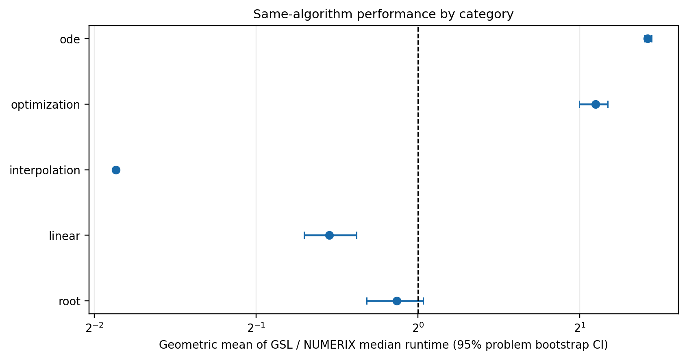
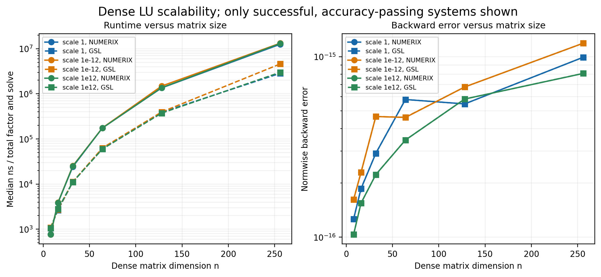
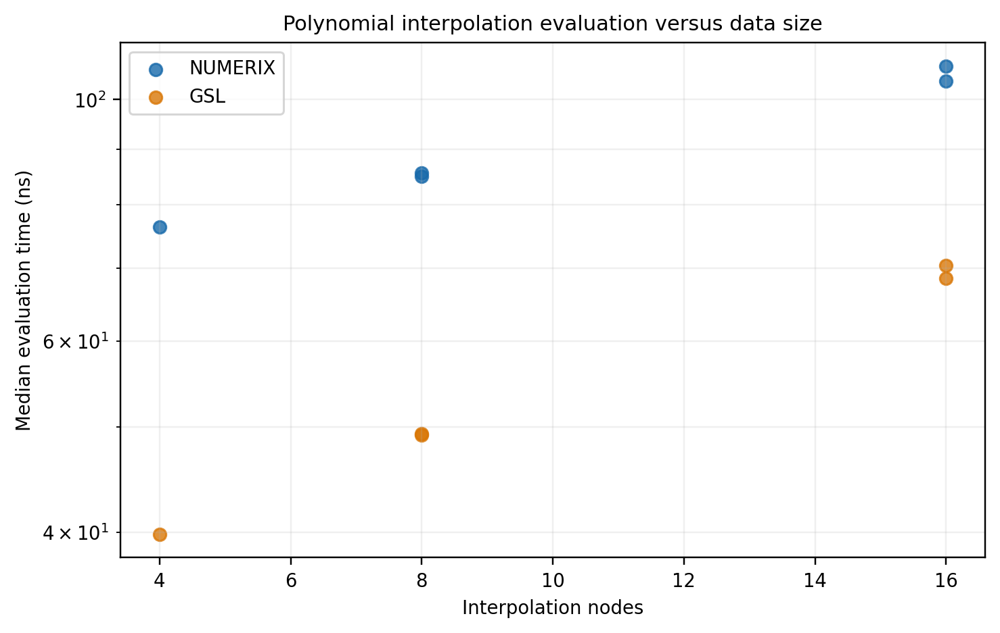
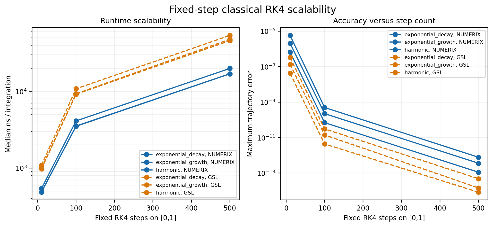
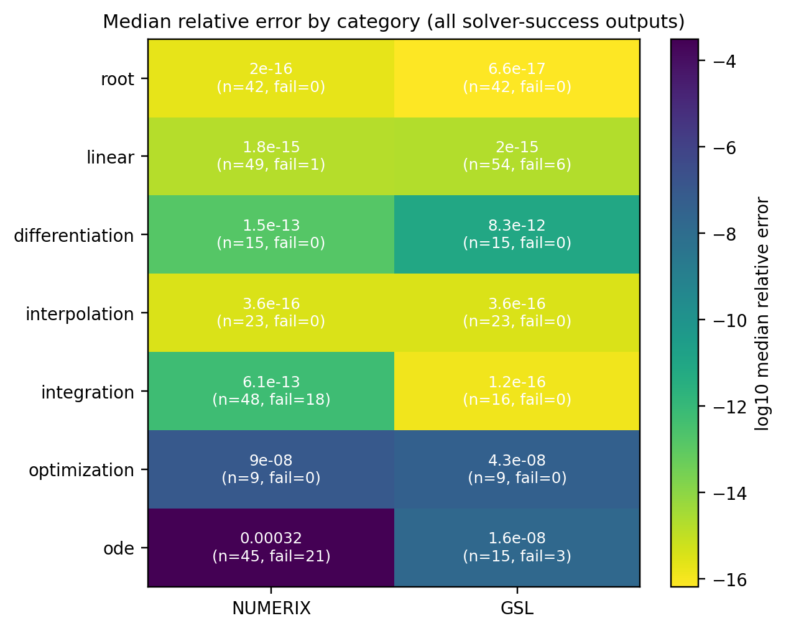
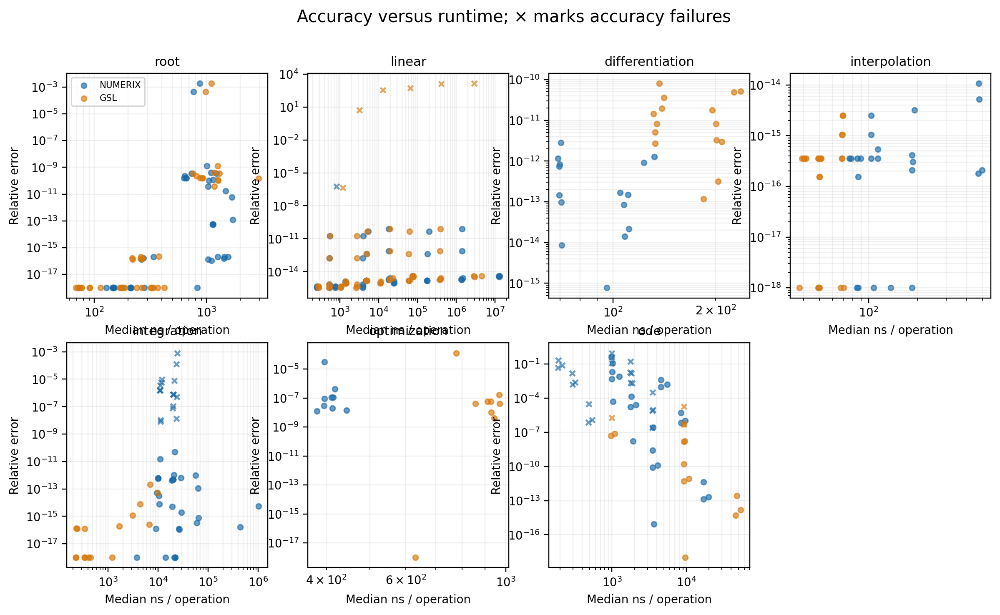
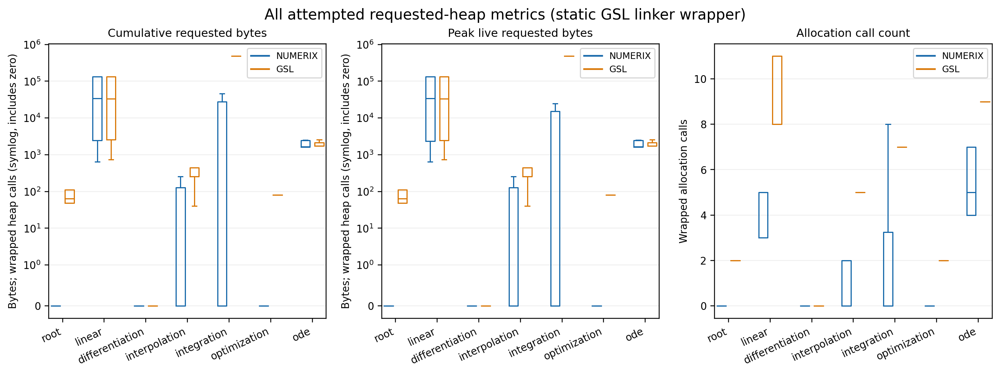

# NUMERIX Comparative Evaluation — Phase 13C + 13D

**Study date:** 12 November 2026<br>
**Benchmark run:** `e6f964c649af4dc1a62ab30dbddc149f`<br>
**Run seed:** `20261112`<br>
**Project version:** `0.2.0-rc1`

## Executive summary

This study measured NUMERIX against GSL 2.8 across 114 distinct mathematical problem configurations in seven numerical categories. The main run retained 21 calibrated timing batches and one separate accuracy probe per batch for every library/workload summary. It contains 520 workload summaries, 10,920 raw timing batches, and 10,920 accuracy probes. All 114 planned configurations were attempted and completed at the manifest level; solver failures and accuracy-gate failures remain visible in the raw records.

The results are mixed by algorithm and phase. NUMERIX was faster in the accuracy-eligible fixed-step RK4 and golden-section comparisons, and in Richardson differentiation versus GSL's adaptive central difference. GSL was substantially faster in adaptive integration and total dense LU factor-and-solve time. Root-finding results depended on the algorithm: bisection was inconclusive, GSL's Newton implementation was faster on the eligible cases, and GSL Brent was faster in an approximate-algorithm comparison. Polynomial interpolation evaluation favored GSL in the tested implementations. The study does not support one overall library ranking.

Correctness constraints materially affect interpretation. NUMERIX's fixed low-order integration rules missed the accuracy gate on 18 of 32 applicable fixed-rule workload records. For ODE, both libraries returned successful status on all attempted RK4 rows, but only 8 of 15 problem configurations qualified for direct timing comparison after the trajectory-accuracy gate. NUMERIX was faster on those 8 eligible RK4 comparisons; GSL had lower median trajectory error and a higher overall RK4 accuracy-pass rate. Failed or inaccurate results were not used to claim a speed advantage.

## 1. Scope and result summary

| Measure | Result |
| --- | ---: |
| Core mathematical configurations planned / attempted / completed | 114 / 114 / 114 |
| Additional NUMERIX-only capability configurations | 16 |
| Workload summary rows | 520: 299 NUMERIX, 221 GSL |
| Solver-status success / failure rows | 500 / 20 |
| Accuracy-passing summary rows | 374 |
| Paired method/phase workload rows | 221 |
| Eligible direct same-algorithm pairings | 95 |
| Eligible best-available or approximate pairings | 67 |
| Excluded or ineligible paired rows | 59 |
| Raw timing batches / separate accuracy probes | 10,920 / 10,920 |
| Measured batches per library/workload summary | 21 |

The 95 direct, 67 other eligible, and 59 excluded/ineligible values are counts of paired method/phase workloads, not unique mathematical problems. Repeated timing batches are never counted as problem configurations. Pairing counts and the reasons for exclusions are in [coverage.csv](../../benchmarks/analysis/phase13c/tables/coverage.csv) and [runtime_pairings.csv](../../benchmarks/analysis/phase13c/tables/runtime_pairings.csv).

### Main runtime findings

The reported ratio is **GSL median runtime / NUMERIX median runtime**. Values above 1 favor NUMERIX; values below 1 favor GSL. Category confidence intervals resample unique problem configurations, so additional phases or timing repetitions do not inflate the number of mathematical cases.

| Comparison | Eligible configurations | GSL / NUMERIX geometric mean (95% problem bootstrap interval) | Reading |
| --- | ---: | ---: | --- |
| Root finding, direct aggregate | 15 | 0.913 (0.803–1.023) | No clear category-level direction |
| LU, direct aggregate of eligible phases | 24 | 0.684 (0.614–0.769) | GSL faster overall, driven by factorization and total time |
| Interpolation, direct linear segment | 1 | 0.274 (no category CI) | One case only; GSL faster in that case |
| Golden-section minimization, direct | 10 | 2.141 (1.996–2.258) | NUMERIX faster in these workloads |
| Fixed-step RK4, direct and accuracy-eligible | 8 | 2.675 (2.637–2.723) | NUMERIX faster on the subset that passed both accuracy gates |

The best-available and approximate results are reported separately because these methods do not represent equivalent algorithms.

| Comparison | Configurations | GSL / NUMERIX geometric mean (95% problem bootstrap interval) | Reading |
| --- | ---: | ---: | --- |
| Richardson differentiation vs GSL adaptive central difference | 15 | 1.892 (1.863–1.924) | NUMERIX faster; NUMERIX also had lower median error on all 15 cases |
| Adaptive Simpson vs GSL QAG 21-point rule | 16 | 0.0260 (0.0156–0.0453) | GSL about 38× faster on these accuracy-eligible runs |
| NUMERIX Brent vs GSL Brent | 14 | 0.254 (0.172–0.397) | GSL about 3.9× faster; safeguards differ, so approximate classification |
| Newton polynomial evaluation vs GSL polynomial evaluation | 11 | 0.595 (0.565–0.627) | GSL about 1.7× faster in the measured evaluation phase |
| Lagrange evaluation vs GSL polynomial evaluation | 11 | 0.223 (0.181–0.272) | GSL about 4.5× faster in the measured evaluation phase |

These are API-level timings under the harness's setup and phase boundaries. They should not be interpreted as isolated instruction-level kernel costs.

## 2. Experimental environment

| Item | Observed value |
| --- | --- |
| Baseline branch / commit | `master` / `6c2ef314bbe0b563dbf2353dd70a3b1ee2748574` |
| Operating system | Oracle Linux Server 8.10; Linux 5.15; x86_64 |
| CPU | Intel Core i5-7400, 4 online cores, 1 socket, no SMT |
| Compiler | GCC 8.5.0 |
| Build | Release, GCC `-O3 -DNDEBUG`; no fast-math |
| GSL | 2.8, local optimized build with bundled CBLAS |
| CMake / Python | CMake 4.4.4 / Python 3.9.25 |
| Analysis packages | NumPy 1.26.4, Matplotlib 3.9.4, SciPy 1.13.1 |
| `double` precision | 64 storage bits, 53 significand bits, exponent bounds −1021 to 1024 |
| Timer | `CLOCK_MONOTONIC`, wall time; CPU time not recorded |
| Benchmark format | Schema v2 |

The optimized GSL build is at `/home/142401034/.local/numerix-deps/gsl-2.8-o3-clean`; the earlier local default-optimization GSL installation is separate. The benchmark executable reported `GSL=2.8` and linked GSL and GSL CBLAS. The CMake and Make GSL benchmark paths were both exercised.

The baseline commit was present, but the repository worktree already contained uncommitted Phase 13B implementation, build, documentation, test, and result changes when Phase 13C began. Those changes were used as the active source tree and preserved. Therefore, the commit hash alone does not identify every source file used by this run. The captured environment metadata includes the dirty status; `source_fingerprints.sha256` in the main run directory fingerprints the relevant source and build files. No commit or push was made, and the version was not changed.

No Windows or macOS run was performed. CPU frequency, host load, and scheduling were not controlled. The machine has four online cores, but the study is a single-process, single-thread numerical comparison.

## 3. Workloads and comparison methodology

The seven-category plan contains 16 root, 30 linear algebra, 15 differentiation, 12 interpolation, 16 integration, 10 optimization, and 15 ODE configurations. The linear algebra set varies dense matrix size across 8, 16, 32, 64, 128, and 256; includes three uniform matrix scales, Hilbert stress systems, and near-rank-one systems. The other categories vary function shape, scale, coordinate, interval, dataset size, or ODE step count where appropriate. Sixteen additional NUMERIX-only probes measure library capabilities but are excluded from the seven-category comparison.

Comparison labels distinguish:

- **Direct:** equivalent algorithm and phase, including bisection, Newton root finding, pivoted LU, golden section, fixed-step classical RK4, and a single linear-interpolation case.
- **Best available:** different algorithms selected for the same problem and target accuracy, including adaptive differentiation and integration.
- **Approximate:** related task but materially different implementation or safeguards, including Brent safeguards and polynomial interpolation methods.
- **Excluded / not supported:** no fair equivalent, a declared incomparable case, a solver failure, an accuracy-gate failure, or unusable timing values.

A paired result was eligible for a performance claim only when both libraries returned status success, both outputs passed the accuracy gate, and both median times were finite and positive. NUMERIX-only trapezoid/Simpson and Euler/Heun rows are capability measurements, not paired comparisons. GSL has no matching harness API for these comparisons. Linear algebra factor-only results have no output accuracy measure; performance claims use the solve-only and total phases with accuracy checked on the resulting solution.

Each library/workload received one untimed warm-up, calibration to batches of at least 2 ms (capped at 1,048,576 operations), and 21 measured batches. Each batch has a separate deterministic, untimed accuracy probe. Library order was counterbalanced in adjacent pairs using seed `20261112`; the order and seed are recorded per row. All samples and outliers were retained. Timing summaries use medians and nearest-rank p95 values; no outlier removal was applied.

For individual paired workloads, the 95% interval bootstraps the NUMERIX and GSL timing batches separately and forms a ratio of resampled medians. Category estimates first combine phases per unique problem with a geometric mean, then bootstrap unique problem configurations (4,000 resamples). Win/loss/tie classification uses an individual paired workload's 95% interval: an interval wholly above 1 is a NUMERIX win, wholly below 1 a GSL win, and otherwise tie/uncertain. This is a descriptive study on one host, not a multi-machine population estimate.

Analytic or declared known references are used for function results, constructed known solutions for linear systems, and closed-form trajectories for ODE. ODE error checks include the final value and maximum trajectory error. The GSL ODE adapter invokes `gsl_odeiv2_step_apply` with fixed steps; it does not use an adaptive driver or step doubling. This is classical fixed-step RK4 on both sides.

### Workload coverage

| Category | Planned | Attempted | Completed | Direct eligible pairs | Best / approximate eligible pairs | Excluded / ineligible pairs |
| --- | ---: | ---: | ---: | ---: | ---: | ---: |
| Root finding | 16 | 16 | 16 | 28 | 14 | 5 |
| Linear algebra | 30 | 30 | 30 | 48 | 0 | 36 |
| Differentiation | 15 | 15 | 15 | 0 | 15 | 0 |
| Interpolation | 12 | 12 | 12 | 1 | 22 | 11 |
| Integration | 16 | 16 | 16 | 0 | 16 | 0 |
| Optimization | 10 | 10 | 10 | 10 | 0 | 0 |
| ODE | 15 | 15 | 15 | 8 | 0 | 7 |
| **Total** | **114** | **114** | **114** | **95** | **67** | **59** |

## 4. Results by category

### 4.1 Root finding

The suite covers bracketed roots, Newton roots, flat and tangent behavior, coordinate and function-value scales, oscillatory functions, and no-bracket cases. Direct bisection has a geometric mean ratio of 1.013 with an interval spanning 1 (0.813–1.224), so the study does not resolve a winner. Direct Newton has ratio 0.802 (0.733–0.876), favoring GSL by about 1.25× on eligible workloads. The Brent comparison is approximate because the safeguards differ; its ratio of 0.254 (0.172–0.397) favors GSL by about 3.9×.

Both libraries had 42 successful statuses out of 47 root method/workload records. Four bracket-method failures were expected rejections where the input did not provide a valid sign-changing bracket (including tangent cases); each library also had one Newton convergence failure on the oscillatory case. Every successful root result passed its applicable accuracy gate. Failures were retained and were not assigned speedup values.



### 4.2 Linear algebra

The linear set includes 30 problem configurations and six dense dimensions from 8 through 256. In the 24 configurations eligible for direct comparison, the solve-only phase slightly favored NUMERIX: GSL/NUMERIX 1.034 (1.016–1.054), about a 3.4% NUMERIX advantage. The total factor-and-solve phase favored GSL: 0.452 (0.364–0.570), or roughly 2.2× faster. The factorization phase is the dominant difference in the larger dense cases. For the ordinary dense system at `n=256`, total medians were about 12.53 ms for NUMERIX and 2.85 ms for GSL; both had relative solution error near `4.0e-15`. These measurements include harness phase setup as defined by the benchmark; they are not a standalone BLAS comparison.

NUMERIX returned success for 74 of 84 linear method/phase records and rejected 10 ill-conditioned factorization attempts. GSL returned success for all 84, but some successful outputs on stress systems did not pass the accuracy gate. Among accuracy-applicable successful rows, NUMERIX passed 48/49 and GSL 48/54. This is why the eligible direct comparison has fewer cases than the planned matrix configurations. The median per-problem error was `1.78e-15` for each library; the median alone hides the ill-conditioned tail and must be read with the reliability table and backward-error plot.



### 4.3 Differentiation

NUMERIX Richardson differentiation was compared as a best-available method with GSL adaptive central difference on 15 configurations. The geometric mean GSL/NUMERIX runtime ratio was 1.892 (1.863–1.924), favoring NUMERIX. NUMERIX's median per-problem error was `1.51e-13`, versus `8.25e-12` for GSL, and NUMERIX had lower error on all 15 configurations. Both libraries returned success and passed the requested accuracy gates on all 15. Since the algorithms and work estimates differ, this is a library-method comparison, not a same-algorithm speed claim.

### 4.4 Interpolation

All 12 planned datasets completed. Both libraries passed the accuracy gate on every applicable construction/evaluation output (23 accuracy-applicable records per library). Polynomial evaluation is approximate rather than direct: GSL was about 1.68× faster than NUMERIX Newton evaluation and 4.48× faster than NUMERIX Lagrange evaluation over 11 eligible problem configurations for each method. The only direct comparison is linear interpolation on one segment/configuration; GSL was faster there, but one case is too little evidence for a category-level claim. Setup and evaluation are separate phases, and these speed ratios refer to evaluation.



### 4.5 Integration

The adaptive Simpson versus GSL QAG 21-point comparison passed the accuracy gate on all 16 configurations. Its geometric mean GSL/NUMERIX ratio was 0.0260 (0.0156–0.0453), about a 38× GSL speed advantage for this workload and tolerance set. These are different adaptive algorithms, so the comparison is best-available rather than same-algorithm. The ratio is only meaningful for the tested cases and thresholds.

The NUMERIX trapezoid and Simpson implementations are included as separate capability measurements. Across those fixed-rule workload-method records, NUMERIX's integration category had 30/48 accuracy passes in total; the 18 misses are retained and excluded from eligible runtime claims. GSL's paired adaptive integration passed 16/16. Do not read the adaptive comparison as a claim that every NUMERIX fixed integration rule is accurate at every chosen workload/tolerance.

### 4.6 Optimization

Golden-section minimization was compared directly on 10 configurations. NUMERIX was about 2.14× faster by geometric mean, with a 95% problem-bootstrap interval of 2.00–2.26. Both libraries passed status and accuracy checks on all 10. The result applies to these one-dimensional objectives and intervals; the benchmark did not compare multidimensional optimizers.

### 4.7 ODE

The comparison uses fixed-step classical RK4 over exponential and harmonic systems at multiple step counts. All solver calls returned success status, but the trajectory accuracy gate passed for 24/45 NUMERIX method rows and 12/15 GSL RK4 rows. Direct timing eligibility therefore covered only 8 of the 15 problem configurations. On that eligible subset, NUMERIX was about 2.67× faster (GSL/NUMERIX 2.675, 2.637–2.723). Across the full category, the median per-problem trajectory error was `2.50e-7` for NUMERIX and `1.59e-8` for GSL; GSL had lower error on all 15 configurations. The speed result cannot be generalized to the seven excluded accuracy-ineligible cases.



## 5. Accuracy, reliability, and memory

### Accuracy summary

The table reports median per-problem error across measured paired methods/phases. The metric is relative error when defined and otherwise absolute error. Units can differ across categories, so only within-category comparisons are useful. The `lower error` counts compare the per-problem medians of the two libraries; they are descriptive and are not a separate hypothesis test.

| Category | Paired problem configurations | NUMERIX median error | GSL median error | Lower-error configurations (NUMERIX / GSL / tie) |
| --- | ---: | ---: | ---: | ---: |
| Root | 15 | `2.07e-16` | `1.57e-16` | 0 / 8 / 7 |
| Linear | 25 | `1.78e-15` | `1.78e-15` | 2 / 5 / 18 |
| Differentiation | 15 | `1.51e-13` | `8.25e-12` | 15 / 0 / 0 |
| Interpolation | 12 | `2.49e-16` | `3.57e-16` | 2 / 8 / 2 |
| Integration | 16 | `5.44e-16` | `1.23e-16` | 3 / 10 / 3 |
| Optimization | 10 | `5.99e-8` | `4.33e-8` | 5 / 5 / 0 |
| ODE | 15 | `2.50e-7` | `1.59e-8` | 0 / 15 / 0 |



### Accuracy-pass and solver reliability

These counts are workload-method-phase records, not unique problems. A single mathematical configuration may contribute multiple methods or phases. Solver status success and accuracy-gate success are reported separately.

| Category | NUMERIX status success | NUMERIX accuracy passes / applicable | GSL status success | GSL accuracy passes / applicable |
| --- | ---: | ---: | ---: | ---: |
| Root | 42 / 47 | 42 / 42 | 42 / 47 | 42 / 42 |
| Linear | 74 / 84 | 48 / 49 | 84 / 84 | 48 / 54 |
| Differentiation | 15 / 15 | 15 / 15 | 15 / 15 | 15 / 15 |
| Interpolation | 34 / 34 | 23 / 23 | 34 / 34 | 23 / 23 |
| Integration | 48 / 48 | 30 / 48 | 16 / 16 | 16 / 16 |
| Optimization | 10 / 10 | 10 / 10 | 10 / 10 | 10 / 10 |
| ODE | 45 / 45 | 24 / 45 | 15 / 15 | 12 / 15 |

The 20 nonzero solver statuses are concentrated in expected bracket rejection, oscillatory Newton nonconvergence, and NUMERIX ill-conditioned factorization rejection. Additional records returned a value but failed an accuracy gate, especially fixed-rule integration and coarse/demanding ODE trajectories. They remain in `accuracy_by_workload.csv`; failed results are visible in the graphs and are not promoted to successful comparisons.



### Requested heap allocation

Memory figures use a separate static-GSL build with linker wrapping of `malloc`, `calloc`, `realloc`, and `free`. They count requested heap bytes and wrapped allocation calls during the recorded setup/operation boundary. They do not measure RSS, stack storage, allocator metadata, or any allocation path outside those wrappers. All 520 memory rows had zero tracked live requested bytes after destruction. The memory distribution chart includes all attempted solver statuses and accuracy outcomes; its byte axes are symmetric-log and include zero-allocation cases.

Direct, accuracy-eligible peak live requested heap medians were:

| Category | Eligible direct pairs | NUMERIX median peak | GSL median peak | Median GSL − NUMERIX |
| --- | ---: | ---: | ---: | ---: |
| Root | 28 | 0 B | 56 B | 56 B |
| Linear | 48 | 33,808 B | 33,928 B | 120 B |
| Interpolation | 1 | 0 B | 40 B | 40 B |
| Optimization | 10 | 0 B | 80 B | 80 B |
| ODE | 8 | 2,080 B | 2,144 B | 64 B |

No direct memory comparison is available for differentiation or integration. The GSL QAG adapter requested 480,088 bytes in the harness; NUMERIX adaptive Simpson allocation varied with recursion (3,072–783,360 cumulative requested bytes). Because they are different algorithms and the setup/workspace behavior differs, these figures are reported separately rather than ranked as equivalent memory use.



## 6. Graph and table index

All analysis products are reproducible from the saved main-run CSVs. Each figure is available in PNG and SVG in `benchmarks/analysis/phase13c/figures/`; source tables are in `benchmarks/analysis/phase13c/tables/`.

| Figure | What it shows |
| --- | --- |
| [Direct category speedup](../../benchmarks/analysis/phase13c/figures/direct_speedup_by_category.png) | Direct category ratios and problem-bootstrap intervals |
| [Best-available ratios](../../benchmarks/analysis/phase13c/figures/best_available_category_ratios.png) | Best-available and approximate category results, separated from direct results |
| [Algorithm/phase heatmap](../../benchmarks/analysis/phase13c/figures/algorithm_performance_heatmap.png) | Direct algorithm and phase ratios |
| [Win/loss/tie heatmap](../../benchmarks/analysis/phase13c/figures/win_loss_tie_heatmap.png) | Count of eligible direct method/phase pairings by interval direction |
| [Direct runtime scatter](../../benchmarks/analysis/phase13c/figures/direct_runtime_scatter.png) | NUMERIX and GSL median times for direct eligible pairs |
| [Relative accuracy](../../benchmarks/analysis/phase13c/figures/relative_accuracy_by_category.png) | Per-result relative error; crosses mark accuracy-gate failures |
| [Absolute accuracy](../../benchmarks/analysis/phase13c/figures/absolute_accuracy_by_category.png) | Per-result absolute error; crosses mark accuracy-gate failures |
| [Accuracy versus runtime](../../benchmarks/analysis/phase13c/figures/accuracy_vs_runtime.png) | Error/runtime distribution, with accuracy failures visible |
| [Timing variability](../../benchmarks/analysis/phase13c/figures/timing_variability_by_category.png) | Raw timing-batch distribution by category and library |
| [LU scalability and backward error](../../benchmarks/analysis/phase13c/figures/linear_scalability_and_backward_error.png) | Dense LU total runtime and normwise backward error by size |
| [Interpolation scalability](../../benchmarks/analysis/phase13c/figures/interpolation_scalability.png) | Polynomial evaluation runtime by node count |
| [ODE scalability and accuracy](../../benchmarks/analysis/phase13c/figures/ode_scalability_and_accuracy.png) | Fixed-step RK4 runtime and maximum trajectory error |
| [Accuracy heatmap](../../benchmarks/analysis/phase13c/figures/category_accuracy_heatmap.png) | Median relative error by category, with failures counted |
| [Reliability heatmap](../../benchmarks/analysis/phase13c/figures/reliability_heatmap.png) | Accuracy-pass rates and solver-status success counts in each cell |
| [Requested heap](../../benchmarks/analysis/phase13c/figures/requested_heap_by_category.png) | All-attempt cumulative requested bytes, peak live bytes, and allocation calls; zero bytes included |
| [Root runtime/accuracy Pareto](../../benchmarks/analysis/phase13c/figures/pareto_root_polynomial.png) | One polynomial root case; case-specific trade-off, not a category ranking |
| [Root runtime/memory Pareto](../../benchmarks/analysis/phase13c/figures/pareto_root_runtime_memory.png) | One root case with nonzero peak heap points |

Key source tables: [coverage](../../benchmarks/analysis/phase13c/tables/coverage.csv), [category performance](../../benchmarks/analysis/phase13c/tables/category_performance.csv), [algorithm performance](../../benchmarks/analysis/phase13c/tables/algorithm_performance.csv), [category accuracy](../../benchmarks/analysis/phase13c/tables/category_accuracy.csv), [reliability](../../benchmarks/analysis/phase13c/tables/reliability.csv), [direct memory](../../benchmarks/analysis/phase13c/tables/category_memory.csv), and all [paired runtime decisions](../../benchmarks/analysis/phase13c/tables/runtime_pairings.csv).

## 7. NUMERIX and GSL strengths observed

**NUMERIX showed competitive or better measured behavior** in Richardson differentiation relative to the tested GSL adaptive central difference, golden-section minimization, and eligible fixed-step RK4. Direct LU solve-only time was close to GSL and slightly favored NUMERIX in the category estimate. The direct root bisection results were statistically unresolved rather than clearly worse. NUMERIX interpolation and differentiation passed all applicable accuracy checks in this workload set.

**GSL showed clear advantages** in adaptive integration runtime, dense LU factor-and-solve time, Newton root timing, and the tested Brent implementation. GSL's polynomial evaluation was faster than the tested NUMERIX Newton and Lagrange evaluation implementations. GSL returned successful status on more ill-conditioned linear algebra rows and had better aggregate ODE trajectory accuracy in these tests. The accuracy outcomes on stress cases still require reading alongside each gate and reference; a success status alone is not evidence of an accurate answer.

## 8. Limitations and interpretation boundaries

- This is one Linux host, one compiler, and one build configuration. It does not establish performance on Windows, macOS, other processors, or other compilers.
- Wall-clock timings are subject to host scheduling and CPU frequency; CPU time and isolated-core conditions were not measured.
- Only GSL 2.8 was integrated. LAPACK/OpenBLAS, NLopt, SUNDIALS, Eigen, and Boost.Math were not present and were deferred because additional adapters and validation would extend the priority-one study.
- The study has no equivalent GSL pairing for NUMERIX trapezoid/Simpson or Euler/Heun capability rows. Multidimensional optimization, higher-dimensional ODEs, and large-scale sparse systems are not covered.
- Accuracy references are analytic or declared known values, but workload diversity remains finite. Accuracy thresholds are method-specific; raw errors and pass gates are both retained.
- Some best-available comparisons use different algorithms and therefore reflect an algorithm-plus-library choice, not implementation speed in isolation.
- Allocation wrapping measures requested heap calls only. It is not RSS or a complete process-memory profile.
- GSL and NUMERIX phase setup and workspace lifetimes differ. Timings should be interpreted at the explicit phase boundary, especially LU factor-only, solve-only, and total phases.
- The root runtime/memory Pareto plots are single-case illustrations and cannot support category-wide ranking.
- The active worktree included uncommitted Phase 13B changes. Source fingerprints and the captured run environment record the working files; the baseline commit alone is insufficient to reconstruct the exact executable.

## 9. Conclusion

The study is **complete with documented limitations**. It establishes reproducible, accuracy-gated measurements across all seven planned numerical categories and preserves raw evidence, manifests, metadata, statistical tables, graphs, and a final report. Results vary substantially by algorithm, phase, and problem size. NUMERIX demonstrates strengths in several tested methods; GSL demonstrates substantial advantages in adaptive integration and dense LU total time, as well as better observed ODE trajectory accuracy. The evidence does not support declaring either library universally better.

## 10. Reproduction

The commands below rebuild and rerun the full benchmark into a **new empty output directory**. They do not overwrite the preserved main run. The exact GSL prefix and CMake executable used for this host are shown; on another system, substitute its installed GSL and CMake paths.

```sh
/tmp/numerix-phase9-tools/python/cmake/data/bin/cmake -S . \
  -B /tmp/numerix-phase13c-rebuild \
  -DCMAKE_BUILD_TYPE=Release \
  -DNUMERIX_BUILD_COMPARISON_BENCHMARK=ON \
  -DGSL_ROOT_DIR=/home/142401034/.local/numerix-deps/gsl-2.8-o3-clean
/tmp/numerix-phase9-tools/python/cmake/data/bin/cmake --build \
  /tmp/numerix-phase13c-rebuild --parallel 4
python3 scripts/run_benchmarks.py \
  --build-dir /tmp/numerix-phase13c-rebuild \
  --output /tmp/numerix-phase13c-reproduced-run \
  --samples 21 --seed 20261112 --compiler gcc \
  --gsl-flags='GSL 2.8; GCC -O3 -DNDEBUG; bundled CBLAS'
```

To regenerate the saved allocation-probe dataset, use the Linux GNU/ELF
allocation target with static GSL and CBLAS, as documented in
[`benchmarks/README.md`](../../benchmarks/README.md#allocation-measurement-and-fault-injection):

```sh
/tmp/numerix-phase9-tools/python/cmake/data/bin/cmake -S . \
  -B /tmp/numerix-phase13c-memory-rebuild \
  -DCMAKE_BUILD_TYPE=Release \
  -DNUMERIX_BUILD_COMPARISON_BENCHMARK=ON \
  -DNUMERIX_BENCHMARK_ALLOCATIONS=ON \
  -DGSL_ROOT_DIR=/home/142401034/.local/numerix-deps/gsl-2.8-o3-clean \
  -DGSL_LIBRARY=/home/142401034/.local/numerix-deps/gsl-2.8-o3-clean/lib/libgsl.a \
  -DGSL_CBLAS_LIBRARY=/home/142401034/.local/numerix-deps/gsl-2.8-o3-clean/lib/libgslcblas.a
/tmp/numerix-phase9-tools/python/cmake/data/bin/cmake --build \
  /tmp/numerix-phase13c-memory-rebuild --parallel 4
/tmp/numerix-phase13c-memory-rebuild/numerix_comparison_memory --memory \
  > /tmp/numerix-phase13c-reproduced-memory.csv
```

From the repository root, regenerate the tables and figures from the saved run (no numerical benchmark rerun required):

```sh
python3 scripts/analyze_phase13c.py \
  --run-dir benchmarks/results/phase13c/main-21samples-seed20261112 \
  --plan benchmarks/analysis/phase13c/workload_plan.csv \
  --memory benchmarks/results/phase13c/memory-instrumented-o3/memory_metrics.csv \
  --output-dir benchmarks/analysis/phase13c
python3 scripts/render_phase13c_report.py
```

Verify the main run and pilot with:

```sh
python3 scripts/verify_benchmark_results.py benchmarks/results/phase13c/main-21samples-seed20261112
python3 scripts/verify_benchmark_results.py benchmarks/results/phase13c/pilot-o3-3samples
```

The main result files are in [the Phase 13C run directory](../../benchmarks/results/phase13c/main-21samples-seed20261112/); the finalized plan is [workload_plan.csv](../../benchmarks/analysis/phase13c/workload_plan.csv). The pilot, expanded pilot, and memory-instrumented run are preserved separately under `benchmarks/results/phase13c/`. The main run has 520 summary rows, 10,920 raw timing rows, 10,920 linked accuracy rows, and environment/build metadata. The [Phase 13B checksum inventory](../development/phase13c_phase13b_checksums.sha256) is retained to make the historical-integrity check repeatable. Phase 9 and Phase 10 checksums are recorded in the Phase 13B completion report.
